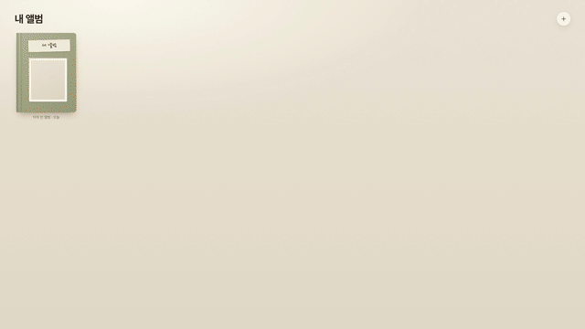
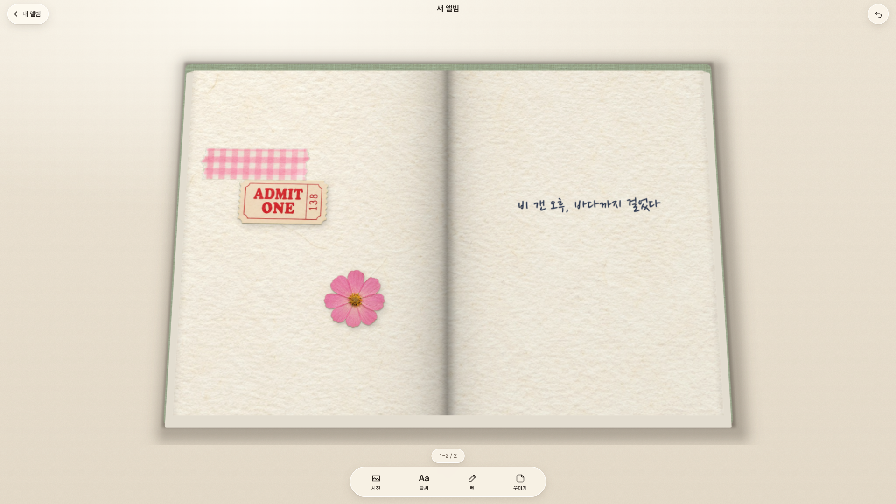
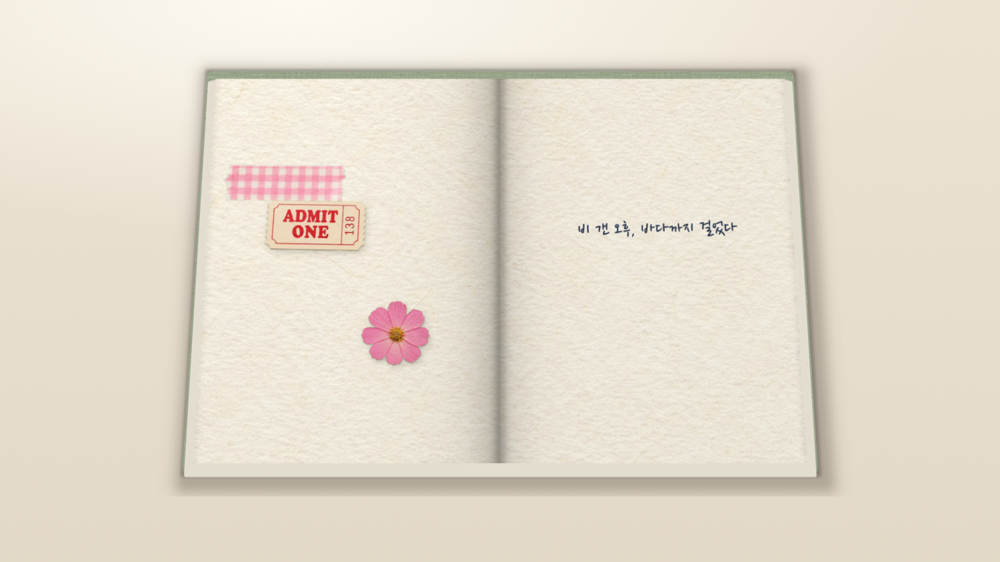

<strong>SAKKU</strong>

<h1 align="center">하루의 조각을 엮는 책</h1>

A book for the pieces of a day: a paper album on screen where you lay keepsakes and a line of handwriting on a tilted page, turn its pages, and when you stop, the tools step back and only the album remains.

The app run locally with its own backend and scratch databases on 14 November 2026. Only the project's own scanned materials are used; no personal photo. <a href="assets/sakku-promo-20261114.mp4">Watch the full film</a> · <a href="assets/sakku-promo-20261114-poster.png">Still frame</a> · <a href="assets/sakku-promo-20261114-manifest.json">Capture details</a>

## Lay the day on the page

Keepsakes go where you put them, and a line of handwriting sits beside them: 비 갠 오후, 바다까지 걸었다 (a clear afternoon after rain; I walked to the sea).

## Then only the album remains

Stop for a moment and the tools fade away: the page is just the page.

## Development status

Sakku (a working name) is in development and runs locally; export, accounts and a public address are future work. The source code is private.

---

[More projects by Hyunjun Kim](https://github.com/EricEremos) · [Get in touch](https://www.linkedin.com/in/ericmos/)
